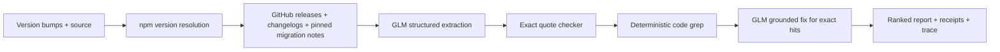

# Upgrade Oracle 5150

**Know what breaks. Before it breaks.** A GLM agent reads real dependency release notes, checks their quotes, searches your source files, and prints a ranked report with evidence receipts.

Built by Kulraj Singh for the DoraHacks Z.AI general bounty. Next.js 16, React 19, TypeScript, GLM-5.3, npm and public GitHub APIs. MIT licensed. No submission, deployment or push is performed by this project.

## Start here

Requires Node.js 20.19+ and npm. No API key is needed for the three recorded demos.

```bash
npm install
npm run dev
```

Open http://localhost:3000. Select a sample cartridge and press **CONSULT THE ORACLE**. The “Demo mode: recorded run” badge is always visible without a key. These are actual captured GLM runs, not hand-written answers or fabricated traces.

| Do this | See this |
| --- | --- |
| Select **Next.js 14.2 → 16.0** and consult | Breaking changes matched to a small App Router app and Next configuration |
| Select **React Router 5.3 → 6.22** and consult | v5 routing APIs matched against the official v6 migration notes |
| Select **ESLint 8 → 9** and consult | Removed rule/context APIs matched to a config and custom rule |
| Open **View evidence receipt** | Exact source quote, pinned URL, source version, interpretation and file:line matches |
| Open **agent trace** | Every URL, method, elapsed milliseconds, byte count, cache hit and failed request |
| Select a verdict counter | Findings filtered by exact, fuzzy or absent API usage |
| Press **JSON** | A portable report containing findings, original fetched notes and the complete trace |
| Edit a sample without a server key | An explicit refusal to misrepresent the edit as a newly analyzed recorded run |
| Run `npm test` | Deterministic tests, including all three demo requests with network disabled |

## Live analysis

Copy `.env.example` to `.env.local`, put your own API key in the file, and restart Next.js. Never commit that file.

```dotenv
GLM_BASE_URL=https://api.tokenfactory.nebius.com/v1
GLM_API_KEY=
GLM_MODEL=zai-org/GLM-5.3
```

The endpoint is OpenAI-compatible chat completions. The browser receives only a live/demo boolean, never the key. The server uses JSON mode, low reasoning effort, temperature 0.1 and bounded completion budgets: 6,000 tokens for extraction and 3,600 for a batch of fixes. Typical recorded completions are much smaller. All upstream requests, including GLM, time out after 10 seconds. The entire API run has a 270-second deadline within a 300-second route budget.

Input modes:

1. **Bumps:** enter `next 14.2.0 -> 16.0.0`, one per line (up to six). Scoped names and semver ranges work. `latest` is allowed as a target.
2. **package.json:** paste the current and target manifests. Only existing dependencies whose ranges changed are considered. Leave the target empty to select npm's latest stable tags. More than six candidates are rejected; use explicit bumps to select a smaller set.
3. **GitHub:** enter `https://github.com/owner/repository`. The agent resolves the default branch to a commit, reads its root `package.json`, and samples at most 30 small files from `src/`, `app/`, `pages/`, `lib/`, `components/`, plus root Next/ESLint config. An optional bump list selects dependencies. Private repositories, branch URLs and repositories without a root manifest are unsupported. Raw reads are pinned to a commit SHA, not a tree SHA.

With pasted input, add up to five source files using the editor, `+` button or upload button. Each file is limited to 20 KB, each manifest to 50 KB and the streamed JSON request to 240 KB. Limits count UTF-8 bytes. Repository samples are individually capped at 20 KB; larger files and generated/vendor directories are excluded.

Version ranges resolve to the **highest currently published matching version**. This is not a lockfile parser: use exact installed versions for reproducibility. Stable versions in `(resolved from, resolved to]` form the review interval. An explicit prerelease target is resolved, but GitHub prerelease notes may be absent. Downgrades and unchanged resolved targets are rejected.

## How GLM is used



GLM extracts `{api, change, migration, sourceVersion, quote}` for up to six changes per dependency. It receives bounded public notes and at most 180 source identifiers to prioritize relevant APIs. Source files themselves are not sent wholesale. Matching snippets for exact hits are sent in a later request for concise fixes grounded in the cited migration text. Instructions treat notes and code as untrusted data.

The deterministic citation checker requires a nontrivial verbatim substring **in a note for the same version**. Invented quotes, normalized whitespace, wrong versions and empty evidence are dropped. A separate deterministic filter excludes deprecation-only claims while retaining removal of previously deprecated APIs. Every receipt refers back to the original fetched text in the downloadable report. The checker verifies provenance, **not semantic entailment**: GLM can still misinterpret a real quote. Fix grounding requires a quoted substring from the migration or evidence; failed fix calls fall back to the extracted migration and show a warning.

Code matching and ranking do not use an LLM:

| Verdict | Meaning |
| --- | --- |
| **Will break** | A bounded, case-sensitive API token occurs in the supplied code. This is a review priority, not proof of execution or breakage. |
| **Might break** | Only a fuzzy match exists: comment/string, case variant, substring, or dotted-token member. |
| **Safe in sample** | No matching token in these files. It does not certify the dependency or whole repository as safe. |

Comments and normal string literals are treated as fuzzy; JSON config keys can be exact. Imports count as usage. Lexical matching cannot resolve aliases, semantic context, dynamic access, template interpolation or behavior changes without API names. Hits are capped at 100 per claim.

Release collection is deliberately bounded: major milestone tags and the target version, up to 100 recent releases, root/package changelogs, and official migration-note adapters for Next 16, Router 6 and ESLint 9. Monorepo tag formats are supported. GitHub's unauthenticated quota, missing notes, excerpted long notes and more than seven major milestones can leave gaps. Coverage shows reviewed version counts and warnings; no-note results never imply compatibility. The model context is capped at 96,000 characters, 50,000 per migration guide and 8,000 per other note. Original notes are retained for receipts.

## API

`POST /api/analyze`, `Content-Type: application/json`:

```json
{
  "bumps": [{ "name": "react-router-dom", "from": "5.3.4", "to": "6.22.0" }],
  "files": [{ "path": "src/App.tsx", "content": "import { Switch } from 'react-router-dom';" }]
}
```

Alternative fields: `packageJson` and optional `targetPackageJson` (JSON text strings), or `repoUrl` plus optional `bumps`. Demo requests must use an unmodified entry from `src/lib/examples.ts`, including `exampleId`. A successful response has `mode`, `dependencies`, `findings`, `notes`, `files`, `coverage`, `warnings`, `trace`, `droppedCitations` and timing metadata. Demo responses add original input and recording timestamp. Error responses contain a safe message and any available trace.

Invalid inputs return 400, oversized uploads 413, non-JSON requests 415, edited demo requests 422, rate limits 429 (with `Retry-After`), and upstream errors 502/503. Source fetches allow only HTTPS npm, GitHub API and raw GitHub hosts, including redirect targets. Provider response bodies, authorization headers, stack traces and environment values are not exposed.

## Rate limits and operational boundaries

The limiter allows **5 analyses per IP per rolling hour and 100 per UTC day** across all IPs, including demos. The inherited in-memory implementation enforces this for a single process. **A multi-instance/serverless deployment needs shared storage for a hard global cap.** Configure both optional Upstash variables in `.env.example` to use atomic Redis limits across instances; configured Redis failures fail closed. No Upstash account or deployment has been created.

Vercel's trusted forwarded-IP header is preferred on Vercel. On another host, your reverse proxy must overwrite `X-Forwarded-For`/`X-Real-IP`; directly exposed clients can otherwise spoof an IP. Without a trusted IP header, requests share the `unknown` bucket. Public unauthenticated GitHub quotas are separate from app limits.

Public registry/release data uses bounded process-memory TTL caches. Source files are never placed in those caches, persisted to disk, or sent to Next's fetch cache. API responses are `no-store`. Reports are retained in the browser until refresh and downloaded only on request. Explicit recording is the exception: it saves the supplied sample sources, public notes and generated report to JSON. A server operator should use non-sensitive samples when re-recording.

## Recordings and reproducibility

The three JSON files in `src/recordings/` were generated by **running the real agent on this box with GLM-5.3**, not by editing model outputs. They include original sample input, original timestamp, all fetched notes, citations and actual request metrics. `scripts/record.ts` requires a key, refuses an empty/no-model run and checks all citations before writing. It can record all examples or selected IDs:

```bash
# Load your local env file without echoing it (Node 20.19+).
node --env-file=.env.local --import tsx scripts/record.ts
node --env-file=.env.local --import tsx scripts/record.ts router
# Or, if GLM_API_KEY is already set in your shell:
npx tsx scripts/record.ts
```

Only intended recording JSON is versionable; keys, `.env*` (except the empty example), secrets, logs, browser artifacts and the two visual references are ignored. Re-recording uses paid model inference and public source requests. Failure traces go into ignored `artifacts/`; a failed run does not replace a valid recording. The two reference images are not shipped in `public/`.

## Verification

```bash
npm test
npm run typecheck
npm run lint
npm run build
npm start
```

Vitest covers semver diffing, markdown/release extraction, exact citations, grep, ranking, caps, cache behavior, redirect restrictions, repository commit pinning, local/shared rate limiting, safe HTTP errors and offline replay of every recording.

For browser checks, run a demo-mode server on port 3000 in another terminal:

```bash
PLAYWRIGHT_BROWSERS_PATH=./.playwright npx playwright install chromium
npm run test:browser
```

This checks sample runs, receipts, Escape/focus behavior, trace expansion, JSON download, edited-input rejection, no runtime errors, axe WCAG AA checks, and layouts at 320/390/768/1440 px. Screenshots and the downloaded report are saved in ignored `artifacts/`. `BROWSER_BASE_URL` can select another local server.

## Project map and credits

| Location | Purpose |
| --- | --- |
| `src/lib/agent.ts` | Real agent orchestration and coverage |
| `src/lib/sources.ts`, `fetcher.ts` | Public sources, bounded transport and trace |
| `src/lib/glm.ts` | OpenAI-compatible JSON extraction and grounded fixes |
| `src/lib/citations.ts`, `matcher.ts`, `versions.ts` | Deterministic verification |
| `src/lib/http.ts`, `input.ts`, `rate-limit.ts`, `shared-limit.ts` | API boundaries and quotas |
| `src/lib/demo.ts`, `src/recordings/` | Honest offline replay |
| `src/components/` | CRT terminal, thermal receipts and trace disclosure |
| `demo-script.md` | A 6½-minute narrated walkthrough |

The package versions, Vercel install config, Vitest setup, TTL cache, rate limiter, streamed HTTP reader, trace disclosure and native receipt dialog patterns are reused/adapted from the sibling `qloo` project as requested. Vitest was upgraded to 4.1.12 after npm reported vulnerabilities in its inherited 3.x dependency tree; the test configuration pattern is retained. Next.js/React versions remain aligned with the reference project.

The night sky, moon, snow peaks, ruined columns, terminal bezel, scanlines and radar are original CSS/SVG, with reduced-motion support. VT323 and IBM Plex Mono are self-hosted; their OFL licenses are in `public/fonts/`. App source is MIT; upstream release-note text and fonts retain their respective licenses.
